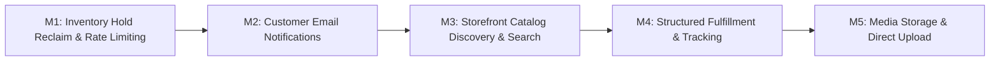

# Cal Cart: Dependency-Aware Implementation Roadmap

This roadmap groups the verified findings from the Product Maturity Audit into small, self-contained, dependency-aware milestones. Each milestone has clear boundaries, explicit exclusions, and rigorous acceptance criteria.

---

## Roadmap Overview

---

## Milestone Matrix

| Milestone | Target Domain | Primary Focus | Gaps Addressed | Est. Effort |
| :--- | :--- | :--- | :--- | :--- |
| **M1 (Complete)** | Reliability & Security | Expired reservation reclamation & Public route rate limiting | **GAP-01**, **GAP-02** | Complete |
| **M2 (Complete)** | Customer Communications | Transactional order lifecycle emails via Resend | **GAP-03** | Complete |
| **M3 (Recommended Next)** | Storefront Discovery | Keyword search, price filtering, catalog sorting | **GAP-05**, **GAP-06** | 3 days |
| **M4** | Merchant Operations | Structured carrier tracking & fulfillment records | **GAP-04** | 3 days |
| **M5** | Platform Infrastructure| Native S3/R2 presigned media upload integration | **GAP-07** | 4-5 days |

---

## Milestone 1: Inventory Hold Reclaim & Rate Limiting Hardening (Recommended Next Milestone)

### 1. Objective
Eliminate inventory leakage from abandoned checkouts by creating an automated worker job to release expired stock reservations, and protect sensitive public authentication and payment endpoints with sliding-window rate limiting.

### 2. Scope
- Create `InventoryExpirationRecoveryJob` in `apps/worker` to scan for and release expired inventory reservations (`expires_at <= NOW()` and `status = 'ACTIVE'`).
- Register `InventoryExpirationRecoveryJob` in `PaymentRecoveryScheduler` under distributed database lease locks.
- Implement lightweight, memory-efficient sliding-window rate limiting middleware in `apps/web/src/lib/rate-limiter.ts`.
- Apply rate limiting to:
  - `POST /api/v1/auth/login` (5 attempts / min per IP)
  - `POST /api/v1/storefront/[storeSlug]/auth/login` (5 attempts / min per IP)
  - `POST /api/v1/storefront/[storeSlug]/checkout/[checkoutId]/payment/verify` (10 requests / min per checkout)

### 3. Explicit Exclusions
- Do NOT rewrite existing payment recovery or order cancellation jobs.
- Do NOT alter cart expiration rules or customer session management.
- Do NOT add external Redis or external caching infrastructure (keep simple modular monolith architecture).

### 4. Modules & Files Likely to Change
- `apps/worker/src/jobs/inventory/inventory-expiration-recovery-job.ts` (new)
- `apps/worker/src/schedulers/payment-recovery-scheduler.ts` (register job)
- `apps/worker/src/index.ts` (wire scheduler)
- `apps/web/src/lib/rate-limiter.ts` (new)
- `apps/web/app/api/v1/auth/login/route.ts` (add guard)
- `apps/web/app/api/v1/storefront/[storeSlug]/auth/login/route.ts` (add guard)
- `apps/web/app/api/v1/storefront/[storeSlug]/checkout/[checkoutId]/payment/verify/route.ts` (add guard)

### 5. Dependencies
- `@shopify-clone/inventory`, `@shopify-clone/db`, `@shopify-clone/config`.

### 6. Acceptance Criteria
1. An active reservation whose `expires_at` has elapsed is detected and released within one scheduler tick (10 seconds), restoring available stock to the item pool.
2. Rapid successive login attempts (> 5 requests in 60s from same IP) return HTTP 429 Too Many Requests with clear error details and `Retry-After` header.
3. Legitimate single authentication and payment calls proceed with zero latency penalty.

### 7. Required Tests
- `tests/worker/inventory-expiration-recovery-job.test.ts`: Integration test verifying that expired holds across multiple stores are reclaimed without touching active holds.
- `tests/security/rate-limiter.test.ts`: Unit and API tests verifying 429 status on threshold breach.

### 8. Regression Risks
- False positives on shared NAT IP addresses if rate limits are set too strictly (mitigated by configuring generous initial threshold of 5 attempts/minute for failed attempts).

---

## Milestone 2: Customer Email Notifications & Commerce Communication Lifecycle (Complete)

### 1. Objective
Keep customers informed throughout the order lifecycle by delivering transactional emails via Resend for order placement, shipment fulfillment, cancellation, and refund using a durable transactional outbox.

### 2. Implemented Scope
- Added database migration `0014_create_notification_outbox_schema.sql` and `NotificationOutboxRepository` with atomic `FOR UPDATE SKIP LOCKED` claim.
- Added responsive HTML and plaintext templates in `packages/email/src/templates/`:
  - `OrderConfirmationEmail`: itemized products, subtotal, discounts, shipping, tax, grand total, and shipping address.
  - `OrderFulfillmentEmail`: order number, carrier name, tracking number, tracking link, and partial fulfillment handling.
  - `OrderCancelledEmail`: order number, cancellation reason, transparent refund status.
  - `RefundConfirmationEmail`: full vs partial refund clarification, refund amount, and return timeframe.
- Implemented `NotificationOutboxService` in `@shopify-clone/orders` and wired triggers:
  - `PaymentOrderIntegration.processCapturedPayment`
  - `POST /api/v1/stores/[storeId]/orders/[orderId]/fulfill`
  - `OrderCancellationCoordinator.cancelOrder`
  - `RefundService.recordRefundSuccess`
- Implemented `NotificationDispatchJob` in `apps/worker` with exponential backoff (1m, 5m, 15m, 30m, 1h), terminal failure handling for invalid addresses, and integrated with `PaymentRecoveryScheduler`.
- Created automated integration test suite `tests/notifications/order-lifecycle-notifications.test.ts` (12 passing tests).

### 3. Verification & Acceptance
- All 12 notification integration tests passing.
- Staging acceptance suite passing (7/7).
- Worker test suite passing (19/19).
- Email integration suite passing (17/17).
- Monorepo typecheck passing across all 20 packages with 0 errors.
- Monorepo linter passing with 0 warnings/errors.

---

## Milestone 3: Storefront Catalog Discovery, Search & Filtering

### 1. Objective
Empower storefront buyers to search products by title/description, filter by price range, and sort by price or date.

### 2. Scope
- Extend `modules/products` `listProducts` with `search`, `minPrice`, `maxPrice`, `sortBy`.
- Add SQL `ILIKE` clauses or trigram indexing on `products.title` and `products.description`.
- Add search input, price range sliders/inputs, and sort dropdown to `apps/web/app/stores/[storeSlug]/products/page.tsx`.

### 3. Explicit Exclusions
- Do NOT introduce external Elasticsearch / Meilisearch cluster (use PostgreSQL built-in search capabilities).

### 4. Acceptance Criteria
- Storefront buyers can search by keyword and immediately see matching product cards.
- Price filtering filters out variants outside the specified min/max range.

---

## Milestone 4: Structured Order Fulfillment & Carrier Tracking

### 1. Objective
Replace free-form tracking strings with structured carrier, tracking number, and tracking URL data models.

### 2. Scope
- Database migration adding `tracking_carrier`, `tracking_number`, `tracking_url` to `orders` (or `order_fulfillments` table).
- Expose structured tracking fields in merchant fulfillment form.
- Render clickable tracking buttons and carrier status badges in customer order confirmation and order history pages.

---

## Milestone 5: Native Cloud Media Storage & Image Upload

### 1. Objective
Allow merchants to directly upload product and variant images from the browser rather than pasting external URLs.

### 2. Scope
- Implement `modules/media` for presigned S3/R2 upload URL generation and validation.
- File dropzone component in merchant product form supporting PNG/JPEG/WebP up to 10MB.
- Automatic image metadata creation and association with product and variant rows.
