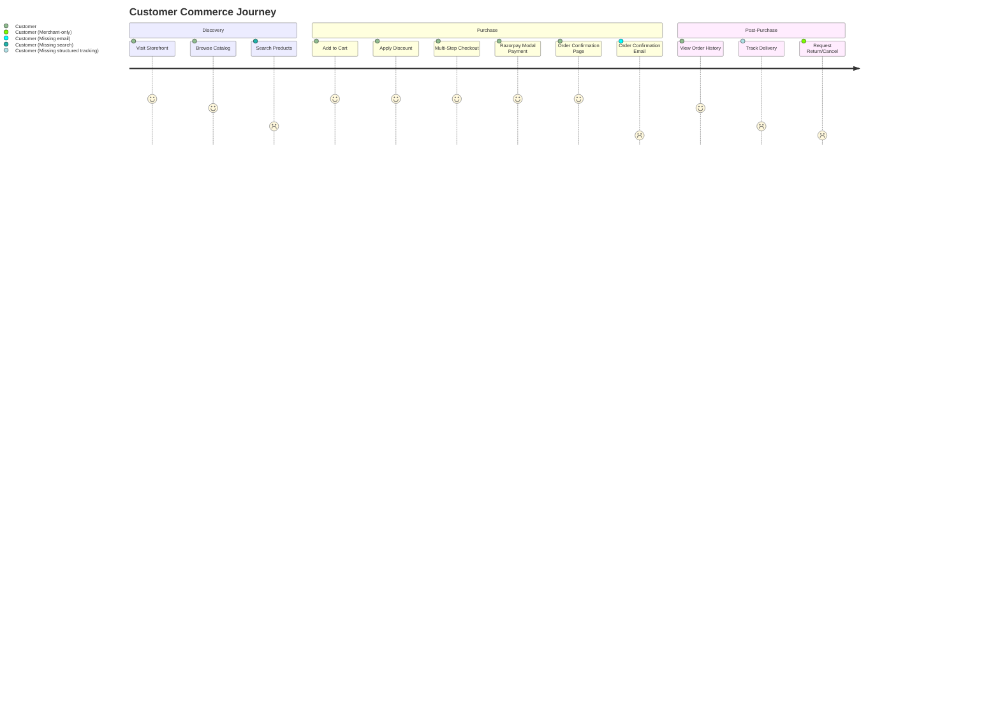
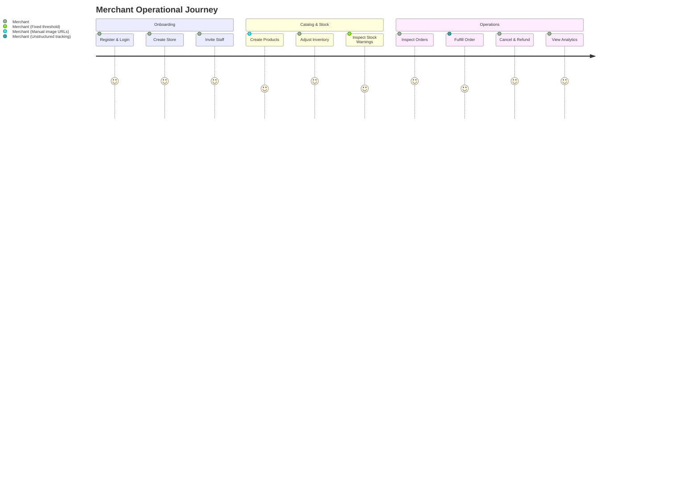

# Cal Cart: Comprehensive Product Maturity Audit

## 1. Executive Summary

This document presents the comprehensive, evidence-based product maturity audit of **Cal Cart**, a multi-tenant commerce platform built as a modular monolith. 

The audit evaluated the codebase across its 9 domain modules, 9 shared packages, 2 applications (`apps/web`, `apps/worker`), 13 database migrations, 104 automated test suites, and all customer and merchant user journeys.

### Key Findings
1. **Core Architecture & Tenant Isolation**: Extremely strong. Tenant isolation is enforced server-side with composite foreign keys, unique indices, and explicit domain guard checks (`CrossStoreOrderAccessError`, `CrossStorePaymentAccessError`, `CrossStoreInventoryAccessError`).
2. **Financial Accounting**: Robust and verified. Merchandise subtotal is isolated from tax and shipping; refunds deduct strictly when `status = 'SUCCEEDED'`; cancelled paid orders reconcile to $0 net sales; negative AOV reporting is supported without artificial clamping.
3. **Inventory & Concurrency**: Safe under high concurrency. Uses `SELECT ... FOR UPDATE` row locks and non-negative constraints. However, there is a **confirmed defect in expired reservation reclamation**: abandoned checkout holds are not automatically released by a background worker job.
4. **Security Controls**: Parameterized SQL queries prevent injection; cryptographic HMAC-SHA256 signatures protect Razorpay webhooks and payment callbacks; guest checkout ownership uses SHA-256 token hashing. However, public auth routes currently lack **rate-limiting middleware** and **Content Security Policy** headers.
5. **Customer Communications**: Transactional emails are configured via Resend for password resets and staff invitations, but **zero order lifecycle emails** (order placed, fulfilled, cancelled, refunded) are implemented.
6. **Storefront Discovery**: Catalog listing supports pagination, but lacks **search filtering, category/collection filtering, and price sorting**.

---

## 2. Current Baseline & Repository Architecture

- **Working Branch**: `ui`
- **HEAD Commit**: `612d0d5` (`test(staging): validate integrated merchant commerce workflows`)
- **Monorepo Layout**:
  - `apps/web`: Next.js 15 application hosting Merchant Admin, Customer Storefront, and JSON API routes.
  - `apps/worker`: Node.js standalone background worker with periodic recovery schedulers.
  - `modules/`: 9 business domain modules (`carts`, `checkout`, `customers`, `discounts`, `inventory`, `orders`, `payments`, `products`, `stores`).
  - `packages/`: 9 shared infrastructure packages (`auth`, `config`, `db`, `email`, `event-bus`, `tenant`, `types`, `ui`, `validation`).
  - `docs/`: System documentation, architecture decision records (`ADR-001` through `ADR-006`), domain specifications.
  - `tests/`: 104 test suites covering unit, domain, schema, integration, security, and UI components.

---

## 3. Module-by-Module Audit

### 3.1 Stores & Tenant Management (`modules/stores`)
- **Responsibilities**: Organization creation, store lifecycle (ACTIVE, SUSPENDED, ARCHIVED), store settings (currency, locale, timezone), team memberships (`owner`, `admin`, `staff`), and email invitations.
- **Entry Points**: `StoreService`, `StoreRepository`, `/api/v1/stores/...`.
- **Database Tables**: `organizations`, `stores`, `store_settings`, `organization_memberships`, `store_memberships`, `store_invitations`.
- **Strengths**: Strict owner protection prevents removing the last owner; slug normalization enforces URL safety.
- **Gaps / Debt**: Store settings are split between `stores` table columns (`currency`, `locale`, `timezone`) and `store_settings` table.

### 3.2 Authentication & Authorization (`packages/auth`, `packages/tenant`)
- **Responsibilities**: User registration, scrypt password hashing, session management via HTTP cookies, token-based password reset, role authorization.
- **Entry Points**: `packages/auth`, `packages/tenant`, `/api/v1/auth/...`.
- **Strengths**: Uses constant-time verification and dummy hash evaluation to prevent timing attacks.
- **Gaps / Debt**: Public login routes lack rate-limiting; CSRF relies on cookie `SameSite=Lax` without double-submit tokens.

### 3.3 Products & Catalog (`modules/products`)
- **Responsibilities**: Product CRUD, variants, prices, SKU tracking, draft/publish/archive state machine, primary media association.
- **Entry Points**: `ProductService`, `ProductRepository`, `/api/v1/stores/[storeId]/products/...`, `/api/v1/storefront/[storeSlug]/products/...`.
- **Database Tables**: `products`, `product_variants`, `product_media`.
- **Strengths**: Cascade deletion on variants and media; composite unique index on `(store_id, slug)` and `(store_id, sku)`.
- **Gaps / Debt**: `listProducts` lacks keyword search and price filters; `/collections` is a stub redirect; no native media upload service.

### 3.4 Inventory & Stock Reservations (`modules/inventory`)
- **Responsibilities**: Stock levels (available vs reserved), adjustment audit history, 15-minute checkout reservation holds, reservation commitment, reservation release.
- **Entry Points**: `InventoryService`, `ReservationReleaseService`, `InventoryRepository`.
- **Database Tables**: `inventory_items`, `inventory_reservations`, `inventory_adjustments`.
- **Strengths**: Atomic concurrency safety using `SELECT ... FOR UPDATE`; check constraint ensures `available_quantity >= 0`.
- **Gaps / Debt**: **GAP-01**: Abandoned reservations are not reclaimed automatically by a background worker job.

### 3.5 Carts & Cart Ownership (`modules/carts`)
- **Responsibilities**: Cart creation, line item mutations, cart calculation, guest cart cookies/headers, cart merging on customer sign-in.
- **Entry Points**: `CartService`, `CartRepository`, `/api/v1/storefront/[storeSlug]/cart/...`.
- **Database Tables**: `carts`, `cart_items`.
- **Strengths**: Flexible caller context supports both guest tokens and authenticated customers; cart merge handles item deduplication.
- **Gaps / Debt**: No background worker job to purge old abandoned carts from the database.

### 3.6 Checkout & Order Creation (`modules/checkout`)
- **Responsibilities**: Converting active cart to checkout, cryptographic guest token hashing, customer email/address capture, price recalculation, order creation handoff.
- **Entry Points**: `CheckoutService`, `CheckoutRepository`, `/api/v1/storefront/[storeSlug]/checkout/...`.
- **Database Tables**: `checkouts`, `checkout_items`.
- **Strengths**: Guest tokens are stored as SHA-256 hashes; status machine enforces checkout immutability on payment initiation.
- **Gaps / Debt**: Automated tax rules and live carrier shipping rate calculations are absent (defaults to standard store delivery).

### 3.7 Discounts & Promotions (`modules/discounts`)
- **Responsibilities**: Store-scoped discount codes, percentage off, fixed amount off, minimum subtotal validation, usage limit counting, date window enforcement.
- **Entry Points**: `DiscountService`, `DiscountRedemptionService`, `DiscountRepository`.
- **Database Tables**: `discounts`, `discount_redemptions`.
- **Strengths**: Safe idempotency on redemptions; currency match enforcement.

### 3.8 Payments & Webhooks (`modules/payments`)
- **Responsibilities**: Razorpay order creation, callback signature validation, webhook signature verification, payment state transitions (PENDING -> CAPTURED / FAILED), full & partial refunds.
- **Entry Points**: `ProviderPaymentService`, `PaymentWebhookService`, `RefundService`.
- **Database Tables**: `payments`, `payment_attempts`, `payment_webhook_events`, `refunds`, `idempotency_records`.
- **Strengths**: Double-checked row locking on refunds; strictly checks order linkage before processing refunds; in-flight ambiguous refund tracking.

### 3.9 Orders, Fulfillment & Cancellations (`modules/orders`)
- **Responsibilities**: Order lifecycle (CONFIRMED -> PROCESSING -> SHIPPED -> COMPLETED / CANCELLED), payment status syncing, fulfillment status transitions, cancellation orchestration.
- **Entry Points**: `OrderService`, `OrderStatusService`, `OrderCancellationCoordinator`, `AnalyticsService`.
- **Database Tables**: `orders`, `order_items`, `order_status_history`.
- **Strengths**: Coordinated cancellation releases reservations and initiates refunds in one transaction; status history records actor audit trail.
- **Gaps / Debt**: Carrier tracking number and carrier name are stored as concatenated string in history rather than structured schema columns.

### 3.10 Customers & Customer Addresses (`modules/customers`)
- **Responsibilities**: Store-scoped customer records, address book, default billing and shipping address tracking, customer status (ACTIVE / DISABLED).
- **Entry Points**: `CustomerService`, `CustomerRepository`.
- **Database Tables**: `customers`, `customer_addresses`.
- **Strengths**: Case-insensitive email normalization with database check constraints; address validation.

### 3.11 Merchant Analytics & Reporting (`modules/orders`)
- **Responsibilities**: Sales overview metrics, orders breakdown, product performance ranking, customer retention analytics, custom date range filtering with prior-period comparison deltas.
- **Entry Points**: `AnalyticsService`, `AnalyticsRepository`, `/api/v1/stores/[storeId]/analytics/...`.
- **Strengths**: Truthful accounting; gross sales is merchandise-only; succeeded refunds only; unclamped negative AOV reporting supported.

### 3.12 Storefront Rendering (`apps/web/app/stores/[storeSlug]`)
- **Responsibilities**: Responsive customer storefront (hero, catalog, product details, cart slider/page, multi-step checkout, order confirmation, account orders).
- **Strengths**: Reusable UI shell; consistent dark/light theme support; guest token preservation across navigation.
- **Gaps / Debt**: Product catalog lacks keyword search bar and filter controls.

### 3.13 Email Delivery (`packages/email`)
- **Responsibilities**: Transactional email templates, HTML layout escaping, Resend provider integration with fallback modes (`development`, `test`).
- **Strengths**: Strict URL protocol validation preventing host-header injection.
- **Gaps / Debt**: Missing order confirmation, shipping update, and cancellation email templates.

### 3.14 Background Jobs (`apps/worker`)
- **Responsibilities**: Periodic schedulers for stalled payment recovery, webhook re-dispatch, and cancelled order refund recovery.
- **Strengths**: Distributed PostgreSQL advisory lease locks prevent concurrent worker collisions.
- **Gaps / Debt**: No job for expired inventory reservation release.

### 3.15 Shared Infrastructure Packages
- `packages/ui`: High-quality accessible design components (`Button`, `Card`, `Table`, `Dialog`, `Alert`, `LoadingIndicator`).
- `packages/validation`: Generic validator interface; HTTP validation implemented via comprehensive schemas in `apps/web`.
- `packages/event-bus`: Abstract interface contracts without concrete runtime implementation.
- `packages/config`: Server and client configuration parser with environment validation.

---

## 4. End-to-End User Journey Audit

---

## 5. Security & Data Integrity Assessment

| Control Area | Implementation Status | Risk Assessment |
| :--- | :--- | :--- |
| **Tenant Isolation** | Server-side `store_id` constraints, foreign keys, and query filters across all 13 tables. | **STRONG** (Verified by 29 automated integration tests). |
| **Authentication** | Scrypt password hashing, secure session cookies, token expiration. | **STRONG**. |
| **Rate Limiting** | Missing on public auth and checkout payment verification routes. | **HIGH RISK** (Vulnerable to credential brute-forcing). |
| **SQL Injection** | 100% parameterized queries via `pg` pool (`$1, $2, ...`). | **SAFE**. |
| **Payment Webhooks** | HMAC-SHA256 signature verification over raw request body text. | **STRONG**. |
| **CSRF Defense** | Cookie `SameSite=Lax` without explicit token validation. | **ACCEPTABLE (Moderate)**. |
| **Content Security Policy** | No CSP headers configured in Next.js middleware. | **LOW RISK (Hardening opportunity)**. |
| **Inventory Holds** | 15-minute lease with row locks; no automated expired lease cleanup. | **HIGH RISK (Resource leakage)**. |

---

## 6. Recommendations & Next Milestone

The single highest-priority next milestone is **Milestone 1: Inventory Hold Reclaim & Rate Limiting Hardening**.
- **GAP-01**: Resolves inventory leakage from abandoned checkouts.
- **GAP-02**: Secures public authentication routes against automated brute-force attacks.

See `docs/audit/implementation-roadmap.md` for full milestone specification and acceptance criteria.
