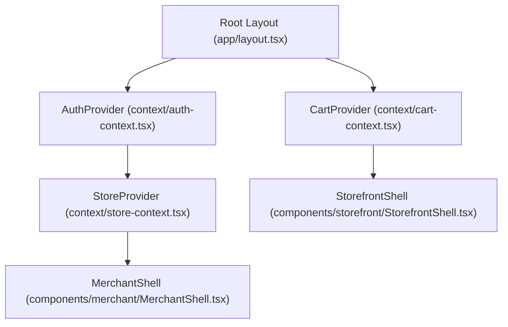

# Frontend Routes, Navigation & Layout Architecture

This document catalogs the complete frontend routing architecture, layout nesting, route parameters, and client context providers across the Cal Cart Next.js application (`apps/web`).

---

## 1. Route Group Overview

The frontend is divided into two primary application portals and public marketing routes:
1. **Public Marketing & Landing**: `/` (Root homepage with storytelling, features, and platform overview).
2. **Merchant Admin Portal**: `/merchant/...` (Merchant dashboard, product management, inventory, orders, analytics, store settings).
3. **Customer Storefront Portal**: `/stores/[storeSlug]/...` (Public storefront, catalog discovery, cart, multi-step checkout, order confirmation, customer account).

---

## 2. Customer Storefront Route Tree (`/stores/[storeSlug]`)

All customer storefront pages are wrapped in `StorefrontShell` with `CartProvider` and optional customer session context.

| Route Path | Type | Dynamic Params | Purpose | Access Control |
| :--- | :--- | :--- | :--- | :--- |
| `/stores/[storeSlug]` | Server / Client | `storeSlug` | Storefront landing page, hero, featured products | Public |
| `/stores/[storeSlug]/products` | Client | `storeSlug` | Full catalog listing with cursor pagination | Public |
| `/stores/[storeSlug]/products/[productSlug]` | Client | `storeSlug`, `productSlug` | Product details, variant selector, add to cart | Public |
| `/stores/[storeSlug]/collections` | Server (Redirect) | `storeSlug` | Redirects to `/products` (collections stub) | Public |
| `/stores/[storeSlug]/about` | Server | `storeSlug` | Store information and merchant story | Public |
| `/stores/[storeSlug]/cart` | Client | `storeSlug` | Dedicated cart management page | Public / Guest / Customer |
| `/stores/[storeSlug]/checkout` | Client | `storeSlug` | Multi-step checkout (info, shipping, delivery, payment) | Guest Token / Customer |
| `/stores/[storeSlug]/orders/[orderId]/confirmation` | Client | `storeSlug`, `orderId` | Order confirmation receipt & summary | Guest Token / Customer |
| `/stores/[storeSlug]/orders/[orderId]` | Client | `storeSlug`, `orderId` | Order status and details view | Guest Token / Customer |
| `/stores/[storeSlug]/login` | Client | `storeSlug` | Customer storefront sign-in | Public |
| `/stores/[storeSlug]/register` | Client | `storeSlug` | Customer storefront account registration | Public |
| `/stores/[storeSlug]/forgot-password` | Client | `storeSlug` | Customer password reset request | Public |
| `/stores/[storeSlug]/reset-password` | Client | `storeSlug` | Customer password reset token entry | Public |
| `/stores/[storeSlug]/account` | Client | `storeSlug` | Customer profile management & address book | Authenticated Customer |
| `/stores/[storeSlug]/account/orders` | Client | `storeSlug` | Customer order history table | Authenticated Customer |

---

## 3. Merchant Admin Route Tree (`/merchant`)

All merchant administration pages are wrapped in `MerchantShell` with `AuthProvider` and `StoreProvider`.

| Route Path | Type | Dynamic Params | Purpose | Required Role |
| :--- | :--- | :--- | :--- | :--- |
| `/merchant/login` | Client | - | Merchant sign-in | Public |
| `/merchant/register` | Client | - | Merchant account registration | Public |
| `/merchant/forgot-password` | Client | - | Merchant password reset request | Public |
| `/merchant/reset-password` | Client | - | Merchant password reset submission | Public |
| `/merchant/invitations/accept` | Client | Query: `token` | Accept store staff invitation | Authenticated User |
| `/merchant/onboarding` | Client | - | New merchant onboarding workflow | Authenticated User |
| `/merchant/stores/new` | Client | - | Create additional store | Authenticated User |
| `/merchant/products` | Client | - | Merchant product list, search, status tabs | `staff`+ |
| `/merchant/products/new` | Client | - | Product creation with variants and pricing | `staff`+ |
| `/merchant/products/[productId]` | Client | `productId` | Product and variant detail editor | `staff`+ |
| `/merchant/inventory` | Client | - | Stock overview table & adjustment dialog | `staff`+ |
| `/merchant/orders` | Client | - | Order list with status tabs | `staff`+ |
| `/merchant/orders/[orderId]` | Client | `orderId` | Order details, fulfillment, cancel, refund | `staff`+ |
| `/merchant/customers` | Client | - | Store customer list | `staff`+ |
| `/merchant/customers/[customerId]` | Client | `customerId` | Customer details, address book, status toggle | `staff`+ |
| `/merchant/discounts` | Client | - | Discount codes list and active status | `staff`+ |
| `/merchant/discounts/new` | Client | - | Create percentage or fixed discount code | `admin`+ |
| `/merchant/discounts/[discountId]`| Client | `discountId` | Edit / toggle discount code | `admin`+ |
| `/merchant/analytics` | Client | - | Sales overview, order trends, top products | `staff`+ |
| `/merchant/team` | Client | - | Team member list and staff invitations | `admin`+ |
| `/merchant/settings` | Client | - | Store settings (currency, locale, archive) | `owner` |
| `/merchant/account` | Client | - | Merchant personal account profile | Authenticated User |

---

## 4. Context Providers & State Hierarchy

